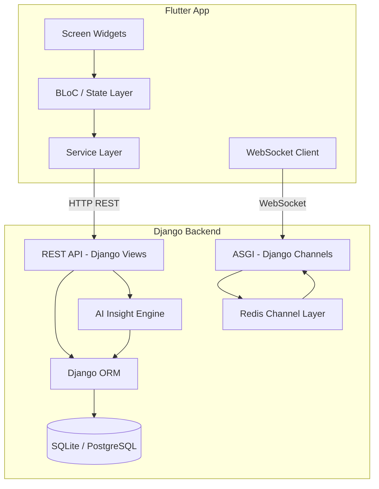
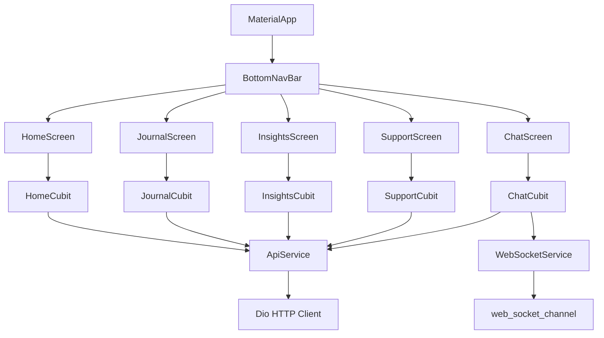
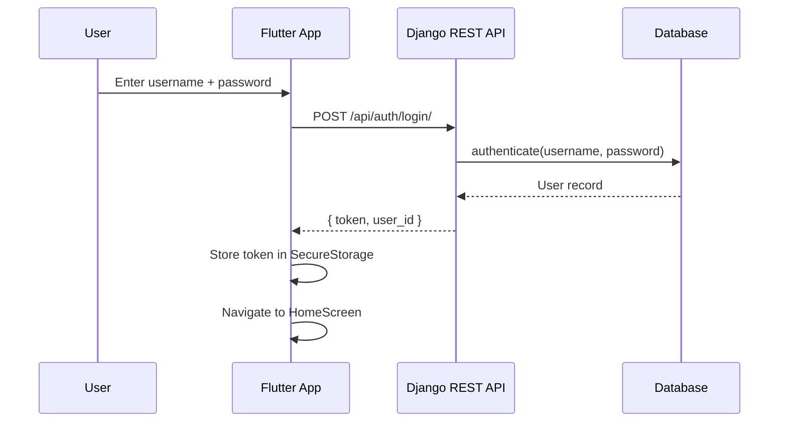
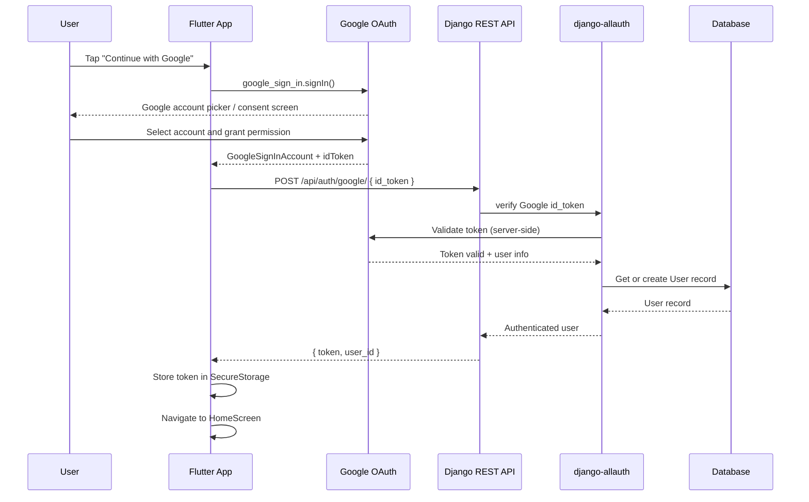
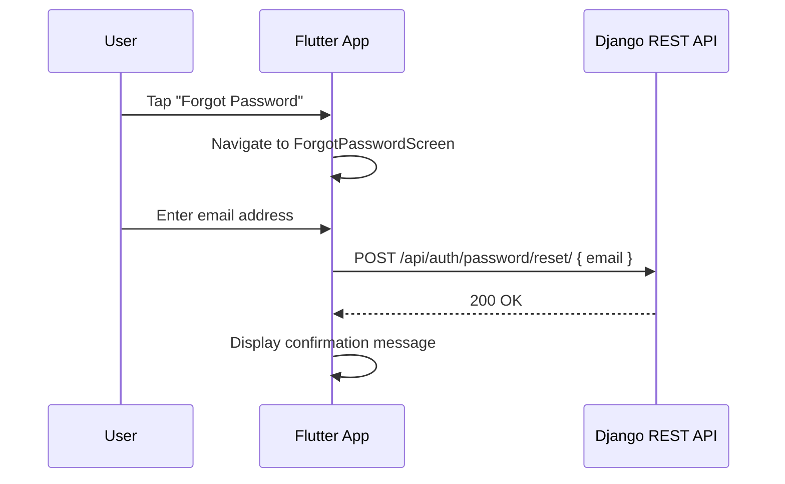
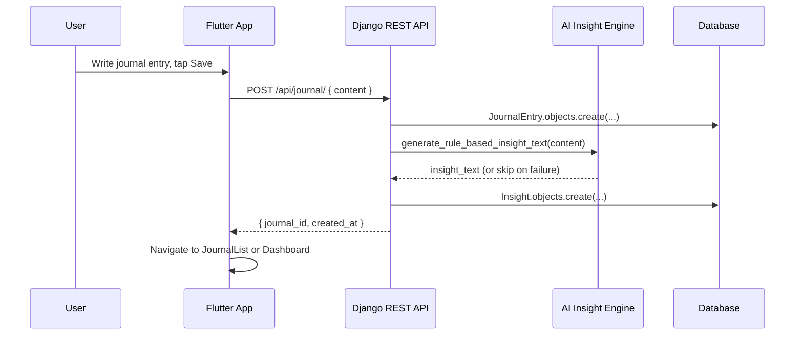
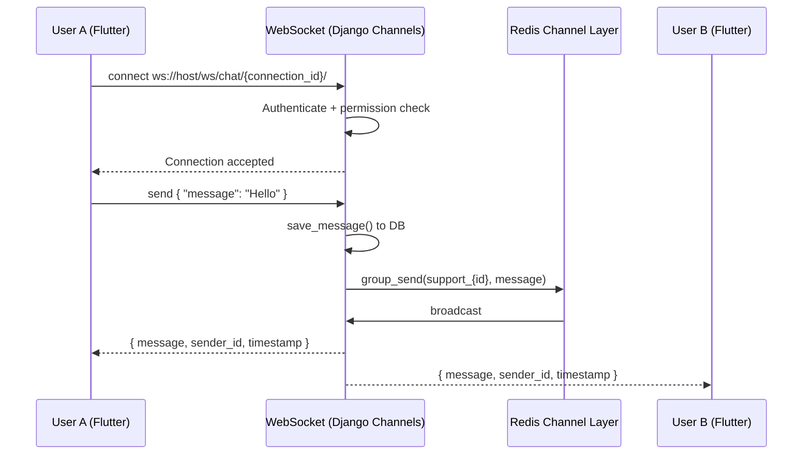
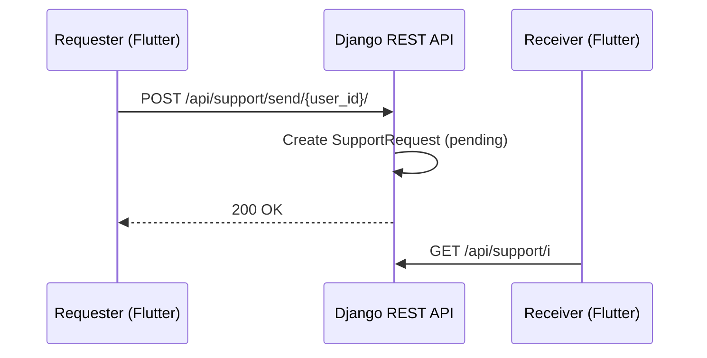

# Design Document: MindSpace Flutter App

## Overview

MindSpace is a privacy-first emotional wellness mobile application built in Flutter, targeting the Google Play Store. It connects to an existing Django/Channels backend via REST API and WebSocket, providing users with private journaling, AI-generated emotional insights, anonymous peer support, and real-time chat — all wrapped in a calm, minimal, emotionally safe UI.

The Flutter app is a pure client: it holds no business logic, performs no AI processing, and stores no sensitive data locally beyond a short-lived auth token. All state lives on the Django backend. The app's role is to present that state clearly and let users interact with it safely.

The five main screens — Home, Journal, Insights, Support, Chat — are navigated via a persistent bottom navigation bar. The design language uses soft blue, sea green, white, and neutral backgrounds with smooth transitions and card-based layouts.

---

## Architecture

### High-Level System Architecture

### Flutter Internal Architecture

---

## Sequence Diagrams

### Authentication Flow — Email/Password

### Authentication Flow — Google Login

### Password Reset Flow

### Journal Create + Insight Generation Flow

### Real-Time Chat Flow

### Support Request Flow

---

## Correctness Properties

*A property is a characteristic or behavior that should hold true across all valid executions of a system — essentially, a formal statement about what the system should do. Properties serve as the bridge between human-readable specifications and machine-verifiable correctness guarantees.*

### Property 1: Authentication round-trip stores token

*For any* valid set of login credentials, submitting them to the login flow should result in the returned auth token being retrievable from SecureStorage.

**Validates: Requirements 1.1, 1.4**

---

### Property 2: Invalid credentials produce non-empty error state

*For any* login or signup attempt that returns an error response from the Backend, the AuthCubit should emit an error state containing a non-empty, human-readable message.

**Validates: Requirements 1.3, 11.5**

---

### Property 3: Mismatched passwords are rejected before network

*For any* pair of strings where the password and confirmation password are not equal, the signup validation should reject the submission and no HTTP request should be made.

**Validates: Requirements 1.5**

---

### Property 4: Logout clears token

*For any* authenticated session, calling logout should result in SecureStorage containing no auth token.

**Validates: Requirements 1.7**

---

### Property 5: Every authenticated request carries Bearer token

*For any* HTTP request made by ApiService while a token is present in SecureStorage, the request should include an `Authorization: Bearer <token>` header.

**Validates: Requirements 1.8**

---

### Property 6: 401 response clears token

*For any* API response with HTTP status 401, the App should clear the token from SecureStorage and emit an unauthenticated state.

**Validates: Requirements 1.9**

---

### Property 7: Dashboard renders all summary fields

*For any* dashboard data payload returned by the Backend, the HomeScreen should render the pending support request count, active connection count, journal entry count, latest journal preview, and unread insight count.

**Validates: Requirements 3.2, 3.3, 3.4, 3.5, 3.6**

---

### Property 8: Whitespace-only input is rejected without network call

*For any* string composed entirely of whitespace characters (including the empty string), submitting it as a journal entry or chat message should be rejected by the App and no network request or WebSocket transmission should occur.

**Validates: Requirements 4.3, 8.4**

---

### Property 9: Content is preserved on save failure

*For any* journal entry content and any save request failure, the JournalCubit error state should retain the original content string so the user does not lose their writing.

**Validates: Requirements 4.5**

---

### Property 10: Lists are displayed in reverse chronological order

*For any* list of journal entries or insights returned by the Backend, the App should display them ordered from newest to oldest based on their `created_at` timestamp.

**Validates: Requirements 5.2, 6.2**

---

### Property 11: Deleted item is removed from list state

*For any* list of journal entries or insights, after a successful delete or dismiss action, the item with the corresponding ID should no longer appear in the Cubit's success state.

**Validates: Requirements 5.4, 6.5**

---

### Property 12: Insight card renders title and message

*For any* Insight object, the rendered insight card widget should contain both the insight title text and the insight message text.

**Validates: Requirements 6.3**

---

### Property 13: Available users list excludes self and connected users

*For any* set of users and active connections, the list of users available to send support requests to should not include the current user or any user already in an active connection with the current user.

**Validates: Requirements 7.2**

---

### Property 14: Accepting a request grows the connections list

*For any* incoming support request, accepting it should result in the SupportCubit's active connections list growing by one entry containing the newly formed connection.

**Validates: Requirements 7.7**

---

### Property 15: Chat message serialization round-trip

*For any* non-empty message string, encoding it as the WebSocket JSON payload `{ "message": "<content>" }` and then decoding that payload should produce the original string.

**Validates: Requirements 8.3**

---

### Property 16: Received message appends to chat list

*For any* chat state with N messages, receiving a new WebSocket message event should result in a chat state with N+1 messages where the last message matches the received content.

**Validates: Requirements 8.5**

---

### Property 17: Message widget renders content, sender identity, and timestamp

*For any* Message object, the rendered message widget should contain the message content, a sender identity indicator (self or other), and a formatted timestamp.

**Validates: Requirements 8.6**

---

### Property 18: WebSocket requires valid token

*For any* WebSocket connection attempt, if no valid auth token is present in SecureStorage, the WebSocketService should reject the connection attempt without opening a socket.

**Validates: Requirements 10.2**

---

### Property 19: Alias is displayed instead of real username

*For any* SupportConnection data where the Backend provides an alias for the peer user, the App should render the alias string rather than the real username in all connection-related UI.

**Validates: Requirements 10.4**

---

### Property 20: All error messages are human-readable strings

*For any* network request failure (HTTP error, timeout, or parse error), the error state emitted by any Cubit should contain a non-empty string that does not contain a raw HTTP status code alone, exception class name, or stack trace.

**Validates: Requirements 11.5**

---

### Property 21: Interactive widgets meet minimum touch target size

*For any* interactive widget (button, tab, list item action) in the App, its rendered size should be at least 48x48 logical pixels.

**Validates: Requirements 11.6**

---

### Property 22: Google Sign-In token is forwarded to backend

*For any* successful Google Sign-In flow that returns a non-null `idToken`, the App should send that token to the backend via POST `/api/auth/google/` and not attempt to authenticate locally.

**Validates: Requirements 1.10**

---

### Property 23: Google Sign-In cancellation produces no state change

*For any* Google Sign-In attempt that is cancelled by the user (null result returned by `google_sign_in`), the AuthCubit should remain in its previous state and no network request should be made.

**Validates: Requirements 1.11**

---

### Property 24: Google Sign-In failure produces non-empty error state

*For any* Google Sign-In attempt where the backend returns an error response, the AuthCubit should emit an error state containing a non-empty, human-readable message.

**Validates: Requirements 1.11**

---

### Property 25: Login screen presents all three authentication options

*For any* rendering of the LoginScreen, the widget tree should contain an email/password form, a "Continue with Google" button, and a "Forgot Password" link.

**Validates: Requirements 1.12**
