# SoulCare Flutter Frontend Architecture Audit

**Audit Date**: July 27, 2026  
**Auditor**: Principal Flutter Architect & Senior Software Engineer  
**Scope**: Full Flutter Frontend Application (`lib/` codebase)  
**Code Modification Status**: **ZERO CODE MODIFICATION (Pure Diagnostic Audit)**  

---

## Executive Summary

A comprehensive architectural audit of the **SoulCare** Flutter application was performed across **20 core software engineering dimensions**. The audit revealed a functionally capable foundation with notable modern Flutter design choices, but identified critical structural anti-patterns, duplicated architecture layers, state management fragmentation, memory leaks, and hardcoded styling tokens that present operational risks as the application scales to production.

---

## Section 1: Core Architecture & Modularization

### 1. Folder Structure & Architectural Drift
- **Severity**: **P0 — Critical Architectural Drift**
- **Why it is a Problem**: The codebase suffers from dual architectural patterns. Legacy monolithic directories (`lib/data`, `lib/domain`, `lib/presentation`) co-exist alongside feature-scoped directories (`lib/features/authentication`, `lib/features/community`, `lib/features/journal`, etc.). For example, screens like [`login_screen.dart`](file:///c:/Users/sujit/OneDrive/Desktop/aiDepressionProject/lib/presentation/screens/login_screen.dart) exist simultaneously in both [`lib/presentation/screens/login_screen.dart`](file:///c:/Users/sujit/OneDrive/Desktop/aiDepressionProject/lib/presentation/screens/login_screen.dart) and [`lib/features/authentication/presentation/screens/login_screen.dart`](file:///c:/Users/sujit/OneDrive/Desktop/aiDepressionProject/lib/features/authentication/presentation/screens/login_screen.dart).
- **Impact**: Developer confusion, duplicate file maintenance, conflicting business logic imports, and circular dependencies between legacy and feature modules.
- **Industry Best Practice**: Maintain a single, consistent feature-first folder structure (`lib/features/<feature>/data`, `domain`, `presentation`) backed by a shared `lib/core` foundation.
- **Recommendation**: Deprecate and delete legacy top-level `lib/data`, `lib/domain`, and `lib/presentation` directories, consolidating all logic into feature modules under `lib/features/`.

### 2. Clean Architecture Compliance
- **Severity**: **P1 — High Priority**
- **Why it is a Problem**: In legacy presentation controllers (e.g., [`login_controller.dart`](file:///c:/Users/sujit/OneDrive/Desktop/aiDepressionProject/lib/presentation/controllers/login_controller.dart)), UI controllers directly invoke repository methods and accept UI callbacks (`required Function(String snackbarMessage) onErrorSnackBar`), breaking the clean boundary between Domain and Presentation layers.
- **Impact**: UI logic is tightly bound to specific framework widgets (SnackBars), rendering unit testing of presentation controllers cumbersome and prone to mock failures.
- **Industry Best Practice**: Controllers should depend strictly on abstract Use Cases (`Domain` layer) and emit immutable State objects. Presentation logic must remain agnostic of specific UI rendering side-effects.
- **Recommendation**: Enforce strict Clean Architecture boundaries by routing all repository calls through Use Cases and emitting state objects consumed by UI `BlocListener` / `Consumer` widgets.

### 3. Feature Modularization
- **Severity**: **P2 — Medium Priority**
- **Why it is a Problem**: Features directly import internal classes from other feature packages (e.g., [`JournalScreen`](file:///c:/Users/sujit/OneDrive/Desktop/aiDepressionProject/lib/presentation/screens/journal_screen.dart) directly instantiates `JournalController` and imports concrete data DTOs), creating tight cross-feature coupling.
- **Impact**: Inability to isolate features for independent testing, code reuse, or multi-package refactoring (e.g., Melos / Flutter packages).
- **Industry Best Practice**: Features should communicate via public API contracts, shared entities in `lib/core`, or dependency-injected interfaces.
- **Recommendation**: Establish clear public API exports for each feature package (`feature_name.dart`) and restrict cross-feature imports to shared domain contracts.

---

## Section 2: Navigation, State Management & Dependency Injection

### 4. Navigation Architecture
- **Severity**: **P1 — High Priority**
- **Why it is a Problem**: Navigation relies on imperative, hardcoded `Navigator.push()` and `Navigator.pop()` calls inside screens rather than a centralized, declarative routing engine.
- **Impact**: Broken deep linking capabilities, inability to restore navigation state on app restart, duplicate route transitions, and difficulty handling dynamic auth guard redirects.
- **Industry Best Practice**: Use a declarative routing framework (`GoRouter` or `AutoRoute`) with strongly-typed routes, dynamic redirection guards, and deep-linking support.
- **Recommendation**: Implement `GoRouter` with centralized route definitions, path parameter type safety, and authentication state redirect guards.

### 5. State Management
- **Severity**: **P1 — High Priority**
- **Why it is a Problem**: Dual state management paradigms are present across the app: legacy `ChangeNotifier` with mutable fields in [`lib/presentation/controllers/login_controller.dart`](file:///c:/Users/sujit/OneDrive/Desktop/aiDepressionProject/lib/presentation/controllers/login_controller.dart), alongside immutable value objects like `LoginState` in [`lib/features/authentication/presentation/controllers/login_controller.dart`](file:///c:/Users/sujit/OneDrive/Desktop/aiDepressionProject/lib/features/authentication/presentation/controllers/login_controller.dart).
- **Impact**: Inconsistent state mutation tracking, unneeded full-widget tree rebuilds when `notifyListeners()` is called, and race conditions during async state transitions.
- **Industry Best Practice**: Standardize on a single, deterministic state management library (`flutter_bloc` or `riverpod`) using immutable state classes (`freezed` or `equatable`).
- **Recommendation**: Migrate all `ChangeNotifier` controllers to `Bloc` / `Cubit` pattern with immutable state representations.

### 6. Dependency Injection (DI)
- **Severity**: **P1 — High Priority**
- **Why it is a Problem**: Dependencies are manually instantiated and passed down through constructor parameters (e.g., `JournalScreen({required this.controller})` and `main.dart` directly instantiating `SoulCareSplashScreen(config: AppConfig.local)`).
- **Impact**: Extreme constructor bloat, difficult mock injection during widget testing, and tight coupling to concrete instances.
- **Industry Best Practice**: Use a service locator (`get_it` with `injectable`) to decouple object creation from usage and manage lifecycle scopes (singletons vs factories).
- **Recommendation**: Configure `GetIt` for global service location and replace manual constructor passing with `sl<JournalController>()`.

---

## Section 3: Data, API Layer & Repositories

### 7. API Layer Architecture
- **Severity**: **P2 — Medium Priority**
- **Why it is a Problem**: Network requests rely on raw HTTP calls without a centralized interceptor pipeline for token auto-refresh, logging, and global retry policies.
- **Impact**: Duplicate headers configuration across datasources, manual bearer token injection, and silent API failures when access tokens expire.
- **Industry Best Practice**: Encapsulate API communication inside a custom HTTP client or `Dio` client with `Interceptors` for automatic JWT refresh (`RefreshTokenInterceptor`), logging, and global error handling.
- **Recommendation**: Create a centralized `ApiClient` wrapper around `http.Client` / `Dio` that handles JWT header injection, 401 token refresh retry loops, and network timeout bounds.

### 8. Repository Pattern & Mapping
- **Severity**: **P2 — Medium Priority**
- **Why it is a Problem**: Several datasources directly return DTOs or raw JSON maps to presentation controllers without transforming them into clean Domain Entities.
- **Impact**: Leaking backend API contract changes (e.g., field name changes) directly into UI widgets, causing cascading UI breakages.
- **Industry Best Practice**: Data sources return DTOs; Repositories map DTOs to pure Domain Entities before returning to Use Cases.
- **Recommendation**: Strictly enforce DTO-to-Entity mapper functions (`toDomain()`) in all Repository implementation classes (`*RepositoryImpl`).

---

## Section 4: UI, Theme, Widget Hierarchy & Responsiveness

### 9. Theme Architecture & Color Token Hygiene
- **Severity**: **P2 — Medium Priority**
- **Why it is a Problem**: While [`app_theme.dart`](file:///c:/Users/sujit/OneDrive/Desktop/aiDepressionProject/lib/core/theme/app_theme.dart) defines a Material 3 design system, individual screen widgets (e.g., [`journal_screen.dart`](file:///c:/Users/sujit/OneDrive/Desktop/aiDepressionProject/lib/presentation/screens/journal_screen.dart)) bypass the theme and hardcode raw hex colors (`Color(0xFF6750A4)`, `Color(0xFF1D1B20)`, `Color(0xFFF7F5FA)`).
- **Impact**: Inconsistent visual styling, broken Dark Mode support on screens using hardcoded light hex values, and high maintenance overhead for branding updates.
- **Industry Best Practice**: Reference all colors via `Theme.of(context).colorScheme` or custom `ThemeExtension` classes. Zero raw `Color(0xFF...)` literals in screen widgets.
- **Recommendation**: Refactor screen widgets to consume `Theme.of(context).colorScheme.primary`, `surface`, `onSurface`, etc.

### 10. Widget Hierarchy & Build Method Complexity
- **Severity**: **P2 — Medium Priority**
- **Why it is a Problem**: Inline modal helper functions like `_showNewEntryModal` in [`journal_screen.dart`](file:///c:/Users/sujit/OneDrive/Desktop/aiDepressionProject/lib/presentation/screens/journal_screen.dart) contain monolithic widget trees (> 90 lines) inside build contexts.
- **Impact**: Reduced readability, unnecessary rebuilds of large widget subtrees, and poor code reusability.
- **Industry Best Practice**: Decompose complex screens into small, dedicated `StatelessWidget` private classes.
- **Recommendation**: Extract inline modals and list items into dedicated private/shared widget components (`_NewEntryBottomSheet`, `_JournalCardWidget`).

### 11. Responsive Design & Screen Adaptation
- **Severity**: **P2 — Medium Priority**
- **Why it is a Problem**: Layouts rely on fixed pixel dimensions (`height: 52`, `padding: 24`) and direct `MediaQuery.of(context).size` calls without `LayoutBuilder` or font scaling bounds.
- **Impact**: Layout overflow errors (`A RenderFlex overflowed by X pixels`) on small screen devices (e.g., iPhone SE) or large font accessibility settings.
- **Industry Best Practice**: Use flexible widgets (`Flexible`, `Expanded`), `SingleChildScrollView`, and responsive breakpoints (`LayoutBuilder`) with scaled padding.
- **Recommendation**: Audit all form screens for scrollability and wrap fixed-height modal containers in `SingleChildScrollView` + `SafeArea`.

### 12. Assets & Resource Organization
- **Severity**: **P3 — Low Priority**
- **Why it is a Problem**: Asset paths are specified as raw hardcoded string literals (e.g., `'assets/icons/journal.svg'`) scattered across widgets.
- **Impact**: Typo risk leading to runtime `AssetNotFoundException` crashes when assets are moved or renamed.
- **Industry Best Practice**: Use generated asset constants (e.g., `flutter_gen` or `AppAssets` class) to ensure compile-time safety for asset paths.
- **Recommendation**: Implement `AppAssets` class with `static const String logo = 'assets/...'`.

---

## Section 5: Non-Functional Requirements (NFRs)

### 13. Performance Optimization
- **Severity**: **P2 — Medium Priority**
- **Why it is a Problem**: Many widget constructors omit the `const` keyword, causing Flutter to re-instantiate identical widget subtrees during every parent rebuild.
- **Impact**: Unnecessary CPU frame drops, higher battery consumption, and UI jank during list scrolling.
- **Industry Best Practice**: Enable `prefer_const_constructors` lint rule and mandate `const` for immutable widget subtrees.
- **Recommendation**: Add `prefer_const_constructors: true` to `analysis_options.yaml` and run `dart fix --apply`.

### 14. Security & Sensitive Data Storage
- **Severity**: **P1 — High Priority**
- **Why it is a Problem**: Auth tokens are handled in memory without explicit secure storage persistence wrappers (`flutter_secure_storage`) across app restarts, and debug logging in some controllers risks printing token strings.
- **Impact**: Potential security leakage of JWT access tokens and loss of session persistence across app terminations.
- **Industry Best Practice**: Store JWT refresh/access tokens in OS Keychains / Keystores via `FlutterSecureStorage`. Strip all sensitive logs in production builds.
- **Recommendation**: Wrap token persistence inside `SecureStorageClient` using hardware-backed encryption.

### 15. Accessibility (a11y)
- **Severity**: **P2 — Medium Priority**
- **Why it is a Problem**: Screen widgets lack explicit `Semantics` wrappers, `InkWell` touch targets fall below 48x48 dp, and interactive icons lack `tooltip` strings for VoiceOver / TalkBack.
- **Impact**: Visually impaired users using screen readers cannot navigate form fields, buttons, or list items effectively.
- **Industry Best Practice**: Ensure minimum touch target sizes of 48x48 dp, provide descriptive `Semantics(label: ...)` for custom buttons, and add tooltips to icon buttons.
- **Recommendation**: Wrap interactive icon buttons with `Tooltip` and audit touch target padding across all form fields.

### 16. Error Handling Architecture
- **Severity**: **P1 — High Priority**
- **Why it is a Problem**: Global error boundaries (`FlutterError.onError`, `PlatformDispatcher.instance.onError`) are missing in [`main.dart`](file:///c:/Users/sujit/OneDrive/Desktop/aiDepressionProject/lib/main.dart). Uncaught async exceptions result in grey screen crashes.
- **Impact**: Poor user experience during unexpected runtime exceptions and missing crash telemetry for unhandled errors.
- **Industry Best Practice**: Wrap `runApp` inside `runZonedGuarded` and configure `FlutterError.onError` to capture and log uncaught exceptions.
- **Recommendation**: Implement global error catching in `main.dart` forwarding uncaught exceptions to `AppObservabilityHooks.recordError()`.

### 17. Loading States & Feedback UI
- **Severity**: **P2 — Medium Priority**
- **Why it is a Problem**: Screen loading states are inconsistent across features; some screens use full-page modal progress overlays while others use custom skeleton loaders without shimmer animations.
- **Impact**: Disjointed user perception of performance and feedback during network operations.
- **Industry Best Practice**: Standardize loading states using shimmer skeleton loaders for list content and inline button spinners for form submissions.
- **Recommendation**: Create a unified `SoulCareLoadingWidget` and apply consistent skeleton shimmer patterns across all feature screens.

### 18. Empty States & Edge Cases
- **Severity**: **P3 — Low Priority**
- **Why it is a Problem**: Empty states (e.g., in [`journal_screen.dart`](file:///c:/Users/sujit/OneDrive/Desktop/aiDepressionProject/lib/presentation/screens/journal_screen.dart)) use basic inline text widgets without actionable call-to-action buttons or dynamic illustration imagery.
- **Impact**: Lower user engagement and less intuitive UX when a feature domain contains no initial records.
- **Industry Best Practice**: Provide visually rich, actionable empty state widgets (`EmptyStateWidget`) with helpful onboarding prompts.
- **Recommendation**: Build a reusable `AppEmptyState` component with illustration, headline, description, and primary CTA button.

### 19. Reusable Component Hygiene (DRYness)
- **Severity**: **P2 — Medium Priority**
- **Why it is a Problem**: Input text fields and primary buttons are repeatedly re-declared with custom `InputDecoration` and `ElevatedButton.styleFrom` blocks across individual screens rather than consuming centralized design system widgets.
- **Impact**: Code duplication, visual inconsistencies when button styles diverge, and elevated maintenance cost.
- **Industry Best Practice**: Maintain a centralized UI component library (`lib/core/widgets/buttons/`, `text_fields/`).
- **Recommendation**: Enforce usage of standardized design system components (`SoulCareButton`, `SoulCareTextField`) across all screen views.

### 20. Technical Debt & Resource Leakage
- **Severity**: **P1 — High Priority**
- **Why it is a Problem**: Inline controller instantiation inside modal sheets (e.g., `final titleCtrl = TextEditingController();` inside `_showNewEntryModal` in [`journal_screen.dart`](file:///c:/Users/sujit/OneDrive/Desktop/aiDepressionProject/lib/presentation/screens/journal_screen.dart)) omits `dispose()` calls.
- **Impact**: Severe memory leaks as un-disposed `TextEditingController` instances accumulate in RAM during repeated modal interactions.
- **Industry Best Practice**: Always manage controller lifecycles inside `StatefulWidget` states and invoke `.dispose()` inside `dispose()`.
- **Recommendation**: Convert modal bottom sheets with text fields into `StatefulWidget` wrappers that properly dispose all input controllers.

---

## Issue Severity Summary Table

| Severity | Total Issues | Key Focus Areas |
| :-: | :-: | :--- |
| **P0 (Critical)** | **1** | Architectural Drift & Dual Folder Structures (`lib/presentation` vs `lib/features`). |
| **P1 (High)** | **6** | Clean Boundaries, Imperative Navigation, Dual State Management, DI, Security Storage, Global Error Catching, Memory Leaks. |
| **P2 (Medium)** | **11** | Feature Coupling, API Interceptors, DTO Mappers, Hardcoded Hex Colors, Large Build Methods, Responsiveness, Performance Lints, Accessibility, Loading States, Reusable Widgets. |
| **P3 (Low)** | **2** | Hardcoded Asset Paths, Basic Empty State Visuals. |

---

## Architectural Remediation Roadmap

```mermaid
flowchart LR
    Phase1[Phase 1: Critical Cleanup] --> Phase2[Phase 2: Core Engineering] --> Phase3[Phase 3: Design & Polish]

    subgraph Phase1
        A1[Consolidate to lib/features/]
        A2[Fix Memory Leaks in Modals]
        A3[Setup Global Error Catching]
    end

    subgraph Phase2
        B1[Implement GoRouter & GetIt]
        B2[Standardize Bloc/State Management]
        B3[Setup ApiClient Interceptors]
    end

    subgraph Phase3
        C1[Eliminate Hardcoded Hex Colors]
        C2[Enforce Reusable UI Components]
        C3[Add Semantics & Accessibility]
    end
```

---
*Audit completed by Antigravity Principal Flutter Architect Engine.*
