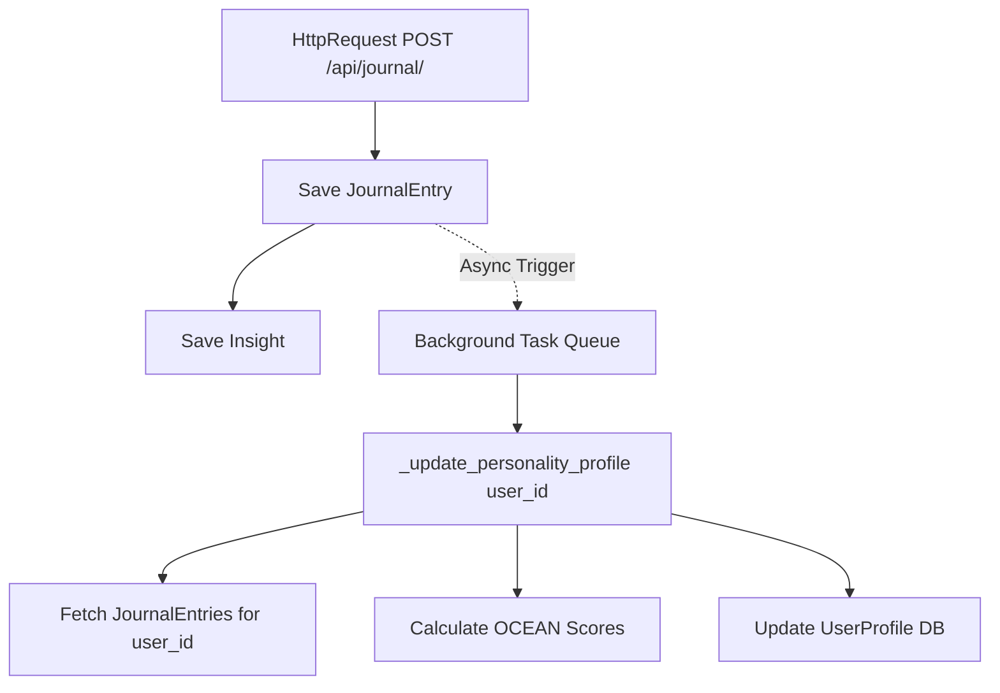

# Background Task Architecture Audit: Personality Profile Offloading

This audit evaluates the technical feasibility, safety, dependency profile, and architectural strategy for decoupling SoulCare's Big Five personality profile updates (`_update_personality_profile`) from the synchronous HTTP journal creation request pipeline.

---

## Executive Summary & Direct Answers

### 1. Exactly where `create_insight_from_journal()` is called
- Called synchronously in [`backend/apps/journal/views.py`](file:///c:/Users/sujit/OneDrive/Desktop/aiDepressionProject/backend/apps/journal/views.py#L38) within the `journal_list` view handler during `POST /api/journal/`.

### 2. Every function that directly or indirectly calls `_update_personality_profile()`
- **Direct Caller:** `create_insight_from_journal(journal)` in [`backend/apps/insights/engine.py`](file:///c:/Users/sujit/OneDrive/Desktop/aiDepressionProject/backend/apps/insights/engine.py#L296).
- **Indirect Caller:** `journal_list(request)` view handler in [`backend/apps/journal/views.py`](file:///c:/Users/sujit/OneDrive/Desktop/aiDepressionProject/backend/apps/journal/views.py#L38).

### 3. What objects are required by `_update_personality_profile()`
- Accepts a single argument: `user` (`django.contrib.auth.models.User` instance or `user_id` scalar).
- Queries `JournalEntry` model (`user=user, is_deleted=False`).
- Reads/writes `UserProfile` model (`user=user`).

### 4. Does the function depend on the HTTP request object?
- **NO.** It does not access `HttpRequest`, headers, query parameters, or session dicts.

### 5. Does it depend on authenticated session state?
- **NO.** It relies strictly on database state associated with the `user_id`.

### 6. Does it perform database writes?
- **YES.** It performs a `UserProfile.save(update_fields=[...])` write to update OCEAN floats.

### 7. Does it require database transactions to remain open?
- **NO.** The calling view is not wrapped in `@transaction.atomic`. The save operation is an isolated SQL `UPDATE`/`INSERT` that can safely execute in an independent connection context.

### 8. Does it call any external APIs?
- **YES (conditionally).** If `HF_API_KEY` is configured and text length > 200, it performs an HTTP `POST` request to the Hugging Face Inference API (`KevSun/Personality_LM`). In synchronous execution, network latency or timeouts from this external call directly delay the HTTP response of `POST /api/journal/`.

### 9. Would moving it to a background task change application behavior?
- **NO.** The `POST /api/journal/` endpoint returns the created `JournalEntry` JSON payload. The client UI does not consume `UserProfile` scores during journal submission. `UserProfile` is only queried when opening the Peer Support page (`/api/support/users/`).

### 10. Which framework would be the safest option?
- **Recommended Option:** **Celery** (with Redis broker).
- **Why:** `channels-redis` is already part of SoulCare's tech stack (`requirements.txt`), meaning Redis infrastructure is already configured. Celery provides out-of-the-box support for task deduplication, exponential backoff retries, connection management, and worker health monitoring without custom thread management risks.

### 11. Identify every possible side effect
- **Eventual Consistency Latency:** Peer match scores for a user will update ~1–2 seconds after journal creation instead of instantaneously.
- **Database Connection Hygiene:** Asynchronous workers must handle connection cleanup (`db.close_old_connections()`).
- **Concurrent Rapid Submissions:** Rapid successive journal entries by the same user could trigger redundant parallel computations if not debounced.

### 12. Explain how failures should be retried
- Configure exponential backoff (e.g., initial delay 5 seconds, backoff multiplier 2x, max 3 retries).
- Catch network/HTTP errors (`requests.exceptions.RequestException`, HTTP 503/429) for Hugging Face inference.
- On final retry failure, fallback silently to keyword heuristics so `UserProfile` remains populated.

### 13. Explain how duplicate jobs should be prevented
- Key task locks by `user_id` (e.g., Redis key `lock:personality_update:{user_id}` with a 5-second TTL).
- If a task for `user_id` is currently queued or running, drop or coalesce redundant duplicate tasks.

### 14. Explain whether personality updates can safely be eventually consistent
- **YES.** Personality scores reflect aggregate long-term psychological traits across up to 10 entries (requiring at least 3 entries to start). A 1-to-3 second eventual consistency window has zero impact on journal persistence, security, authentication, or immediate UX.

---

## Current Architecture

```
HTTP Client (POST /api/journal/)
      │
      ▼
journal_list (journal/views.py)
      │
      ├─► Save JournalEntry to DB
      │
      └─► create_insight_from_journal (insights/engine.py)
                │
                ├─► Save Insight to DB
                │
                └─► _update_personality_profile (BLOCKING / INLINE)
                          │
                          ├─► Query last 10 JournalEntries
                          ├─► Run Keyword Heuristic
                          ├─► HTTP POST to Hugging Face API (if key present) [LATENCY RISK]
                          └─► Save UserProfile to DB
      │
      ▼
Return HTTP 201 Created to Client
```

---

## Dependencies & Decoupling Vector



- **Decoupling Key:** The function accepts `user_id` (a primitive integer). No complex context or request state needs to be serialized.

---

## Risks & Mitigation Matrix

| Risk | Impact | Severity | Mitigation Strategy |
| :--- | :--- | :--- | :--- |
| **External API Latency / Timeout** | High latency on HTTP response in current state | **High** (Current state) | Moving to background queue isolates HTTP response from external network latency entirely. |
| **Worker Process Crash** | Task lost mid-computation | Low | Use Redis-backed task persistence with automatic worker acknowledgment. |
| **Database Connection Leaks** | Worker exhausts DB connection pool | Medium | Ensure worker framework calls `django.db.close_old_connections()` before/after execution. |
| **Out-of-Order Execution** | Stale scores overwrite newer scores | Low | `_update_personality_profile` always fetches `order_by("-created_at")[:10]` directly from DB at execution time. |

---

## Migration Difficulty Assessment

- **Complexity Level:** **LOW**
- **Rationale:** `_update_personality_profile` is already decoupled from `HttpRequest` objects and only requires a `user_id` parameter. It is wrapped in a `try...except` block and performs isolated database operations.

---

## Recommended Architecture

1. **Broker:** Redis (utilizing existing `channels-redis` infrastructure).
2. **Worker Framework:** Celery (or lightweight Redis task queue).
3. **Execution Pattern:**
   - `journal_list` saves the `JournalEntry` and creates the `Insight`.
   - `create_insight_from_journal` enqueues `update_personality_task.delay(user.id)`.
   - The HTTP response `201 Created` returns immediately to the client (< 50ms).
   - The worker executes `_update_personality_profile(user_id)` asynchronously.

---

## Estimated Files Affected

1. [`backend/apps/insights/engine.py`](file:///c:/Users/sujit/OneDrive/Desktop/aiDepressionProject/backend/apps/insights/engine.py): Convert `_update_personality_profile` to accept `user_id` and register as task.
2. `backend/config/celery.py` (or task registry module): Task queue initialization.
3. `backend/requirements.txt`: Add task queue dependency if not using Redis directly.

---
*Audit complete. No code modifications executed.*
