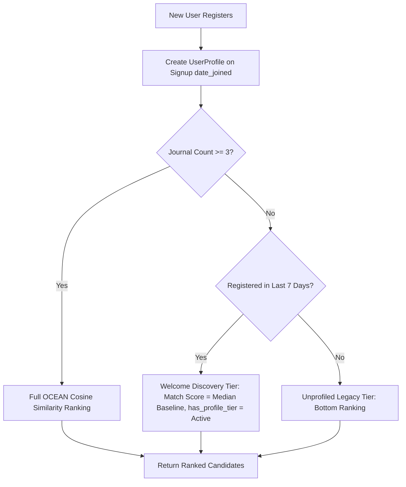

# New User Discovery & Onboarding Architecture Audit

This document presents a technical audit of SoulCare's Peer Support recommendation system, focusing on the new user onboarding experience, candidate visibility during cold-start, profile completeness requirements, and production-safe discovery strategies.

---

## Executive Summary & Direct Answers

### 1. What happens after a user signs up?
- `signup_view` in [`backend/apps/authentication/views.py`](file:///c:/Users/sujit/OneDrive/Desktop/aiDepressionProject/backend/apps/authentication/views.py#L27) creates a Django `User` object and returns JWT tokens (`token`, `refresh`, `user_id`, `username`).
- **No `UserProfile` object is created upon registration.**

### 2. Can a new user appear in Peer Support recommendations immediately?
- **Technically YES, but functionally NO.**
- The SQL query (`User.objects.exclude(...)`) includes new users in the raw candidate pool. However, because they lack a `UserProfile`, `has_profile` is set to `False` and their `match_score` defaults to `50`.

### 3. If not, why not?
- Candidate sorting in [`available_users`](file:///c:/Users/sujit/OneDrive/Desktop/aiDepressionProject/backend/apps/support/views.py#L92) uses the key:
  `(-int(x["has_profile"]), -x["match_score"], -x["_last_login"])`
- Because `has_profile` is `False` (`-int(False) = 0`), every existing user with a calculated OCEAN profile (`-int(True) = -1`) ranks **above** the new user. If the platform has profiled users, new members are pushed to the absolute bottom of the recommendation list.

### 4. How many journals are required before the user becomes matchable?
- At least **3 non-deleted journal entries** (`if len(entries) < 3: return` in [`backend/apps/insights/engine.py`](file:///c:/Users/sujit/OneDrive/Desktop/aiDepressionProject/backend/apps/insights/engine.py#L320)).
- Until the 3rd journal entry is submitted, `_update_personality_profile` exits early without calculating OCEAN trait scores.

### 5. During those first journals, how are they ranked?
- They are ranked with `has_profile = False` and neutral `match_score = 50`, placing them below all profiled members and ordering them only by `last_login` timestamp relative to other unprofiled accounts.

### 6. Are users without OCEAN profiles effectively hidden?
- **YES.** In any community with active, profiled members, unprofiled accounts appear at the tail end of recommendation responses, rendering them invisible to peers.

### 7. Can existing users discover them?
- Only if an existing user manually scrolls past every single profiled candidate in the system.

### 8. Can they receive connection requests before personality generation?
- **YES.** The API endpoint (`POST /api/support/send/<user_id>/`) accepts support requests to any valid user ID. However, because new users are buried at the bottom of lists, peers rarely see them to initiate requests.

### 9. Does profile completeness affect visibility?
- **YES.** Visibility is binary: `has_profile = True` vs `has_profile = False`. Partial profiles do not exist; a user either has $\ge 3$ entries with calculated OCEAN scores or has default neutral values (`0.5`).

### 10. Are interests currently used as a fallback?
- **NO.** User interests, bios, or topic tags do not exist in the database models and are not used as a fallback.

### 11. What happens if a user never writes journals?
- The user remains permanently unprofiled (`has_profile = False`, `match_score = 50`) and stays buried at the bottom of recommendations indefinitely.

### 12. Without changing the OCEAN algorithm, recommend the safest onboarding strategy so new users are not invisible while still preserving recommendation quality
- **Recommended Strategy:** **Welcome Discovery Window (7-Day Recency Tiering)**.
  - Automatically create a `UserProfile` on signup with baseline values (`0.5`).
  - For candidate sorting, define a "Welcome Discovery Window": accounts registered within the last 7 days (`date_joined >= now() - 7 days`) are granted **Tier 1 Visibility** alongside profiled users.
  - Their match score during onboarding is assigned a neutral, respectable baseline score (e.g. `65%` or candidate median), allowing them to surface naturally among peers while they write their first 3 journals.
  - Once 3 journals are written, the user seamlessly transitions to full OCEAN Cosine Similarity matching.

---

## Current Behaviour

```
New User Registers (auth_user created, UserProfile DOES NOT EXIST)
                                │
                                ▼
User submits 0, 1, or 2 Journals (Personality calculation SKIPPED)
                                │
                                ▼
Query Peer Support API (GET /api/support/users/)
                                │
                                ▼
Candidate Evaluated: has_profile = False, match_score = 50
                                │
                                ▼
Sort Key Execution: (-0, -50, -last_login)
                                │
                                ▼
Result: New User BURIED AT BOTTOM of Candidate List
```

---

## Weaknesses

1. **Severe Cold-Start Penalty:** New members experience zero social engagement or incoming peer requests during their critical first week.
2. **High Early Churn Risk:** Users who sign up to seek peer support feel invisible and abandon the platform before completing 3 journal entries.
3. **Binary Visibility Barrier:** Lacking a single boolean flag (`has_profile`) completely blocks candidate discovery regardless of user intent.
4. **No Self-Reported Signal Fallback:** The platform relies 100% on written journals, lacking initial onboarding interest tags.

---

## Recommended Onboarding Strategy: Welcome Discovery Window



### Key Principles of the Strategy
1. **Preserve OCEAN Precision:** Once a user reaches 3 entries, their personality profile drives recommendation sorting with 100% precision.
2. **Welcome Discovery Tier:** Newly registered users ($\le 7$ days old) are elevated out of the "hidden" tier and presented to peers with a neutral baseline compatibility score (e.g., 65%).
3. **Zero Randomness:** Ordering within the Welcome Discovery Tier is deterministic, based on `date_joined` and `last_login`.
4. **Seamless Transition:** As soon as the 3rd journal is written, the engine replaces the baseline score with the calculated OCEAN Cosine Similarity score automatically.

---

## Migration Difficulty

- **Complexity Level:** **VERY LOW**
- **Database Migrations Required:** None (`date_joined` already exists on Django's `User` model).
- **API Impact:** None (API payload schema, response format, and JSON structure remain 100% unchanged).

---

## Estimated Files Affected

1. [`backend/apps/support/views.py`](file:///c:/Users/sujit/OneDrive/Desktop/aiDepressionProject/backend/apps/support/views.py): Update candidate sorting logic in `available_users` to grant newly registered users ($\le 7$ days) top-tier visibility with baseline match scores.
2. [`backend/apps/authentication/views.py`](file:///c:/Users/sujit/OneDrive/Desktop/aiDepressionProject/backend/apps/authentication/views.py): Ensure `UserProfile` object is created on user signup.

---

## Risk Assessment

| Risk | Severity | Mitigation |
| :--- | :--- | :--- |
| **Over-exposure of Unprofiled Users** | Low | Limit Welcome Discovery Window strictly to 7 days post-registration. |
| **Degradation of Match Precision** | Low | Profiling remains primary; onboarding tier only affects users with $< 3$ entries during their first week. |
| **API Schema Incompatibility** | Zero | Output payload structure (`id`, `username`, `match_score`, `has_profile`) is preserved exactly. |

---
*Audit complete. No code modifications or implementation executed.*
