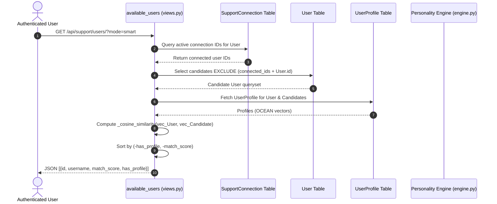
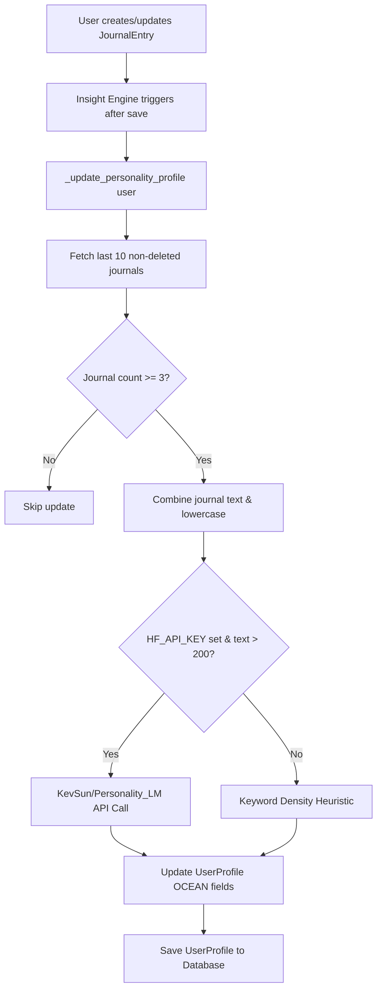

# Peer Support Matching Architecture Audit

This document presents a comprehensive technical audit of SoulCare's Peer Support suggestion pipeline, covering endpoints, backend services, database schema, privacy controls, ranking algorithms, and systemic evaluation.

---

## Executive Summary & Direct Answers

### 1. Which API endpoint provides peer suggestions?
`GET /api/support/users/`
- Query Parameters:
  - `mode=smart` (default): Returns candidates ranked by Big Five personality compatibility.
  - `mode=all`: Returns unranked list of eligible candidates.

### 2. Which backend function/service generates them?
- **Primary View Handler:** `available_users(request)` in [`backend/apps/support/views.py`](file:///c:/Users/sujit/OneDrive/Desktop/aiDepressionProject/backend/apps/support/views.py#L30)
- **Vector Math Engine:** `_cosine_similarity(a, b)` in [`backend/apps/support/views.py`](file:///c:/Users/sujit/OneDrive/Desktop/aiDepressionProject/backend/apps/support/views.py#L14)
- **Profile Computation Engine:** `_update_personality_profile(user)` in [`backend/apps/insights/engine.py`](file:///c:/Users/sujit/OneDrive/Desktop/aiDepressionProject/backend/apps/insights/engine.py#L302)

### 3. Which database tables are used?
- **`auth_user`** (`django.contrib.auth.models.User`): Primary user registry for candidate pool selection.
- **`support_supportconnection`** (`apps.support.models.SupportConnection`): Used to filter out existing active connections.
- **`support_userprofile`** (`apps.support.models.UserProfile`): Stores Big Five OCEAN personality trait vectors.
- **`journal_journalentry`** (`apps.journal.models.JournalEntry`): Evaluated asynchronously to compute personality traits.

### 4. Which user attributes are considered?
- **Considered:**
  - Big Five OCEAN personality traits (`openness`, `conscientiousness`, `extraversion`, `agreeableness`, `neuroticism`).
  - Connection Status (excludes already connected users and self).
- **Not Considered:**
  - Journal raw text / sentiment score (not directly used during recommendation API call; only used upstream to derive Big Five traits).
  - Mood / Sleep records.
  - Interests, Bio, Age, Gender, Activity telemetry.
  - Random selection / seed shuffling.

### 5. Is journal content analyzed?
- **Yes**, indirectly when updating `UserProfile`.
- **How:** Up to the last 10 non-deleted journal entries (`JournalEntry.objects.filter(user=user, is_deleted=False).order_by("-created_at")[:10]`) are concatenated and evaluated.
- **Which Model:**
  - *Default:* Keyword density heuristic mapping (`_keyword_score`).
  - *Optional AI Model:* Hugging Face inference using `KevSun/Personality_LM` (if `HF_API_KEY` environment variable is set and text length > 200 chars).
- **Which Output:** 5 floating point scores (0.0 to 1.0) stored on `UserProfile`: `openness`, `conscientiousness`, `extraversion`, `agreeableness`, `neuroticism`.

### 6. Is raw journal text ever exposed to another user?
- **NO.** Raw journal text is strictly private to the author. It is never returned in API payloads, never transmitted over peer sockets, and never exposed in support match listings.

### 7. How is user privacy protected?
- Candidate API responses contain **only** `id`, `username`, `match_score` (percentage 0–100), and `has_profile` (boolean flag).
- Personality trait vectors (`openness`, `neuroticism`, etc.) are hidden from candidate list payloads.
- Support connections use anonymized default aliases (`alias_user_one`, `alias_user_two`) such as `user_1` / `user_2`.
- Strict authentication via JWT Bearer tokens (`@permission_classes([IsAuthenticated])`).

### 8. Explain the ranking algorithm step by step.
1. Authenticate request user ($U$).
2. Retrieve active connections where $U$ is `user_one` or `user_two`. Exclude active peers and $U$ itself from the candidate set.
3. Query `User` table for all remaining candidates ($C$).
4. Fetch `UserProfile` for $U$. Extract 5D vector $\vec{V}_U = [O, C, E, A, N]$.
5. Bulk fetch `UserProfile` for candidates $C$ in a single SQL query (`CandidateProfiles`).
6. For each candidate $c \in C$:
   - Extract candidate vector $\vec{V}_c$.
   - Calculate Cosine Similarity:
     $$\text{Similarity}(\vec{V}_U, \vec{V}_c) = \frac{\vec{V}_U \cdot \vec{V}_c}{\|\vec{V}_U\| \|\vec{V}_c\|}$$
   - Map similarity float (0.0–1.0) to rounded integer percentage score: $\text{MatchScore} = \text{round}(\text{similarity} \times 100)$.
   - If either user lacks profile data (all default `0.5` scores), assign neutral similarity `0.5` (score = `50`).
7. Sort candidate list using stable dual key sorting:
   - Primary Sort: `has_profile` descending (users with derived profiles appear first).
   - Secondary Sort: `match_score` descending (highest compatibility score first).

### 9. If multiple users qualify, how are they ordered?
- Candidates with calculated profiles are prioritized first, ordered from highest `match_score` (100) to lowest (0).
- Candidates with equal `match_score` or without calculated profiles (`has_profile = False`) maintain database query order.

### 10. If no suitable match exists, what happens?
- If all available users are already connected to $U$ (or no other users exist), the API returns an empty array `[]` with HTTP status `200 OK`.
- If candidates exist but none have populated personality profiles, all candidates are returned with `has_profile: false` and `match_score: 50`.

---

## Architecture & Data Flow

### Background Personality Computation Pipeline

---

## Privacy Analysis

| Data Type | Storage Location | Exposed to Peers? | Exposed via API? | Privacy Mitigation |
| :--- | :--- | :--- | :--- | :--- |
| **Raw Journal Text** | `journal_journalentry` | **No** | **No** | Access restricted to author `user_id`. |
| **OCEAN Vector Scores** | `support_userprofile` | **No** | **No** | Used internally for cosine math; omitted from API serializers. |
| **Match Percentage** | Computed on-the-fly | **Yes** (to requester) | **Yes** (`match_score`) | Aggregate scalar (0–100) preventing vector reverse-engineering. |
| **User Identity** | `auth_user` | **Yes** (Username) | **Yes** (`username`) | User ID & Username exposed; real names/emails hidden. |
| **Chat Connections** | `support_supportconnection` | **Yes** (Alias) | **Yes** (`alias`) | System generates neutral aliases (`user_X`) for chat view. |

---

## Matching Logic & Mathematical Formulation

The matching score is computed using standard Cosine Similarity between 5-dimensional vectors in OCEAN space:

$$\vec{A} = [O_A, C_A, E_A, A_A, N_A], \quad \vec{B} = [O_B, C_B, E_B, A_B, N_B]$$

$$\text{Similarity}(\vec{A}, \vec{B}) = \frac{\sum_{i=1}^{5} A_i B_i}{\sqrt{\sum_{i=1}^{5} A_i^2} \sqrt{\sum_{i=1}^{5} B_i^2}}$$

- Scores are rounded to 4 decimal places, scaled by 100, and converted to integer percentage (`0` to `100`).
- If either vector equals the neutral baseline `[0.5, 0.5, 0.5, 0.5, 0.5]`, similarity defaults to `0.5` (50% match score).

---

## Weaknesses

1. **Static Preference Model (Homophily Assumption):**
   - Cosine similarity prioritizes users with identical personality profiles (homophily). In peer support, matching high Neuroticism with high Neuroticism may be suboptimal compared to complementary matching (e.g. high Agreeableness / Extraversion with high Neuroticism).

2. **Cold-Start Problem:**
   - Users with fewer than 3 journal entries have default profiles (`0.5` across all traits), resulting in uniform 50% match scores for all unprofiled candidate pairs.

3. **Keyword Heuristic Simplicity:**
   - The primary fallback relies on static keyword matching (e.g., `"curious"`, `"plan"`, `"help"`), which can be gaming-vulnerable or inaccurate for complex emotional reflections.

4. **Lack of Recency Weighting:**
   - Personality profiles treat all 10 recent journals equally regardless of whether they were written 1 day ago or 6 months ago.

5. **No Exclusion for Blocked/Disconnected Users:**
   - Currently, `available_users` filters out `STATUS_ACTIVE` connections. Disconnected or previously rejected users are not permanently excluded from appearing in suggestions.

---

## Possible Improvements (Non-Binding Reference)

1. **Complementary Trait Weighting:**
   - Introduce weighted distance metrics allowing specific high-support traits (e.g., high Agreeableness) to boost compatibility scores for users experiencing distress.

2. **Exclusion Persistence:**
   - Include `STATUS_BLOCKED` and `STATUS_DISCONNECTED` in `connected_ids` filtering to prevent deleted connections or blocked users from reappearing in recommendations.

3. **Demographic / Crisis Filtering:**
   - Incorporate time-zone, language preference, or safety status flags into the candidate query.

4. **Deterministic Tie-Breaking:**
   - Add a secondary tie-breaker (e.g., `id` or `date_joined`) to stabilize candidate lists when match scores are equal.

---
*Audit completed without code modifications.*
