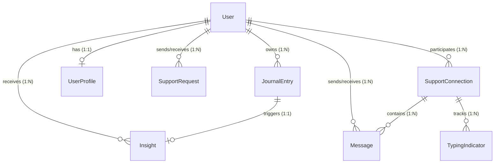

# SoulCare Backend Understanding & Integration Specification

Single Source of Truth analysis of the **SoulCare Django REST & WebSocket Backend Service** to guide seamless, type-safe Flutter frontend implementation.

---

## 1. Feature Overview

The SoulCare backend is a production-grade Django service powering an emotional wellness ecosystem. It comprises 5 core feature domains:

1. **Authentication & Identity**: User registration, credential authentication (email/username), Google OAuth2 token verification, password reset email workflows, and SimpleJWT token rotation/blacklisting.
2. **Reflective Journal**: CRUD management of personal text entries with soft-delete capabilities and post-save hooks that trigger AI analysis.
3. **AI Insights & Sentiment Engine**: Automated NLP pipeline utilizing VADER compound polarity scoring (-1.0 to +1.0), keyword extraction, emotion tag mapping, and dynamic Big Five (OCEAN) personality trait updates.
4. **Peer Support Network & Matching Engine**: Anonymized peer discovery ranked via Cosine Similarity of Big Five personality vectors, support request lifecycle (`pending`, `accepted`, `rejected`, `expired`), and connection management (`active`, `blocked`, `disconnected`).
5. **Real-Time Support Chat**: ASGI/Channels WebSocket communication over secure channels with query-string JWT authentication and crisis safety moderation.

---

## 2. Authentication Flow Analysis

```
                       ┌─────────────────────────┐
                       │   Client Request Payload │
                       └────────────┬────────────┘
                                    │
           ┌────────────────────────┼────────────────────────┐
           ▼                        ▼                        ▼
  ┌──────────────────┐    ┌──────────────────┐    ┌──────────────────┐
  │  POST /signup/   │    │   POST /login/   │    │  POST /google/   │
  │ (user, email,    │    │ (username/email, │    │ (id_token verify)│
  │   pass, confirm) │    │    password)     │    └────────┬─────────┘
  └────────┬─────────┘    └────────┬─────────┘             │
           │                       │                       │
           └───────────────────────┼───────────────────────┘
                                   │
                                   ▼
                      ┌─────────────────────────┐
                      │ Token Issue Response    │
                      │ - access_token (JWT)    │
                      │ - refresh_token (JWT)   │
                      │ - user_id, username     │
                      └────────────┬────────────┘
                                   │
               ┌───────────────────┴───────────────────┐
               ▼                                       ▼
  ┌───────────────────────────┐           ┌───────────────────────────┐
  │ Authorization: Bearer JWT │           │ ws://...?token=<JWT>      │
  │ (REST Endpoints)          │           │ (WebSocket Handshake)     │
  └───────────────────────────┘           └───────────────────────────┘
```

### 2.1 Signup (`POST /api/auth/signup/`)
- Accepts `username`, `email`, `password`, `password_confirm`.
- Validates password parity, email format, and username uniqueness.
- Creates `User` instance and immediately returns issued JWT access & refresh tokens.

### 2.2 Login (`POST /api/auth/login/`)
- Accepts `username` (or registered email) and `password`.
- Performs dual-lookup: attempts standard username auth first, falls back to email-based lookup.
- Returns issued JWT access & refresh tokens on success.

### 2.3 Google OAuth (`POST /api/auth/google/`)
- Accepts `id_token` string.
- Verifies signature using `google.oauth2.id_token.verify_oauth2_token`.
- Automatically calls `User.objects.get_or_create` based on Google account email.
- Returns issued JWT access & refresh tokens.

### 2.4 Token Lifecycle & Logout
- **Access Token**: Short-lived JWT included in HTTP header `Authorization: Bearer <access_token>`.
- **Refresh Token**: Used at `POST /api/auth/token/refresh/` to obtain a fresh access token.
- **Logout (`POST /api/auth/logout/`)**: Blacklists the provided refresh token in Django SimpleJWT blacklist database.

---

## 3. Database Schemas & Model Relationships



### Models Summary:
1. `User` (`django.contrib.auth.models.User`): Primary user identity.
2. `JournalEntry`: Stores reflection `content`, timestamps, and `is_deleted` soft-delete flag.
3. `Insight`: Stores `sentiment_score` (-1.0 to 1.0), `mood` classification, extracted `keywords` (JSON), `emotion_tags` (JSON), and dismissal states (`is_read`, `is_dismissed`).
4. `UserProfile`: Stores Big Five (OCEAN) vector (`openness`, `conscientiousness`, `extraversion`, `agreeableness`, `neuroticism`) and `dominant_emotion`.
5. `SupportRequest`: Tracks peer request lifecycle (`pending`, `accepted`, `rejected`, `expired`) with a 7-day expiration window.
6. `SupportConnection`: Represents active peer connections between `user_one` and `user_two` (canonical ID ordering) with anonymous peer display aliases.
7. `Message`: Stores UUID message records with safety `moderation_status` (`clean`, `flagged`).

---

## 4. API Endpoints & Contract Reference

| Domain | Method | URL Endpoint | Auth Required | Request Payload | Response / Status |
| :--- | :--- | :--- | :--- | :--- | :--- |
| Auth | `POST` | `/api/auth/signup/` | No | `{username, email, password, password_confirm}` | `{token, refresh, user_id, username}` (`201`) |
| Auth | `POST` | `/api/auth/login/` | No | `{username, password}` | `{token, refresh, user_id, username}` (`200`) |
| Auth | `POST` | `/api/auth/google/` | No | `{id_token}` | `{token, refresh, user_id, username}` (`200`) |
| Auth | `POST` | `/api/auth/logout/` | Yes | `{refresh}` | `{detail: "Logged out."}` (`200`) |
| Auth | `POST` | `/api/auth/password/reset/` | No | `{email}` | `{detail: "If that email exists..."}` (`200`) |
| Journal | `GET` | `/api/journal/` | Yes | None | `[{journal_id, content, created_at, updated_at}]` (`200`) |
| Journal | `POST` | `/api/journal/` | Yes | `{content}` | `{journal_id, content, created_at, updated_at}` (`201`) |
| Journal | `GET` | `/api/journal/<id>/` | Yes | None | `{journal_id, content, created_at, updated_at}` (`200`) |
| Journal | `PATCH` | `/api/journal/<id>/` | Yes | `{content}` | `{journal_id, content, created_at, updated_at}` (`200`) |
| Journal | `DELETE` | `/api/journal/<id>/` | Yes | None | Empty Body (`204`) |
| Insights | `GET` | `/api/insights/` | Yes | None | `[{insight_id, title, message, mood, sentiment_score, ...}]` (`200`) |
| Insights | `POST` | `/api/insights/dismiss/<id>/`| Yes | None | `{detail: "Insight dismissed."}` (`200`) |
| Support | `GET` | `/api/support/users/?mode=smart` | Yes | None | `[{id, username, match_score, has_profile}]` (`200`) |
| Support | `POST` | `/api/support/send/<user_id>/` | Yes | None | `{request_id, from_user, to_user, status}` (`201`) |
| Support | `GET` | `/api/support/requests/` | Yes | None | `[{request_id, from_user, to_user, status}]` (`200`) |
| Support | `POST` | `/api/support/accept/<req_id>/`| Yes | None | SupportConnection Schema (`200`) |
| Support | `GET` | `/api/support/connections/` | Yes | None | `[{connection_id, peer_username, peer_alias, status}]` (`200`) |
| Dashboard| `GET` | `/api/dashboard/` | Yes | None | `{pending_requests_count, active_connections_count, journal_count, latest_journal_preview, unread_insights_count}` (`200`) |
| Chat REST| `GET` | `/api/chat/<conn_id>/messages/`| Yes | None | `[{message_id, sender_id, receiver_id, content, created_at}]` (`200`) |

---

## 5. WebSocket Architecture & Messaging Flow

- **Handshake URL**: `ws://<host>/ws/chat/<connection_id>/?token=<access_token>`
- **Authentication**: `JwtAuthMiddleware` extracts `token` from query string parameters, decodes the SimpleJWT token, verifies validity, and populates `scope["user"]`.
- **Consumer Logic (`apps/chat/consumers.py`)**:
  - Joins Channel Layer group `chat_<connection_id>`.
  - Scans outbound text for crisis keywords prior to broadcast.
  - Broadcasts structured JSON events (`chat_message`, `typing_indicator`).

---

## 6. Frontend Integration Considerations

1. **Token Persistence & Injection**:
   - Store access and refresh tokens in `flutter_secure_storage`.
   - Inject `Authorization: Bearer <token>` in every HTTP Data Source request.
2. **Auto-Trigger Awareness**:
   - Creating a journal entry automatically generates an insight on the backend. The frontend should trigger a background refresh of `InsightsController` after a successful journal POST.
3. **Smart Peer Matching Ratings**:
   - The `/api/support/users/?mode=smart` endpoint returns candidate peers pre-sorted by Big Five Cosine Similarity (0-100 `match_score`). Display this score in peer connection UI components.
4. **WebSocket Connection Lifetime**:
   - Establish WebSocket connection when opening `ChatScreen` and disconnect on widget disposal.
