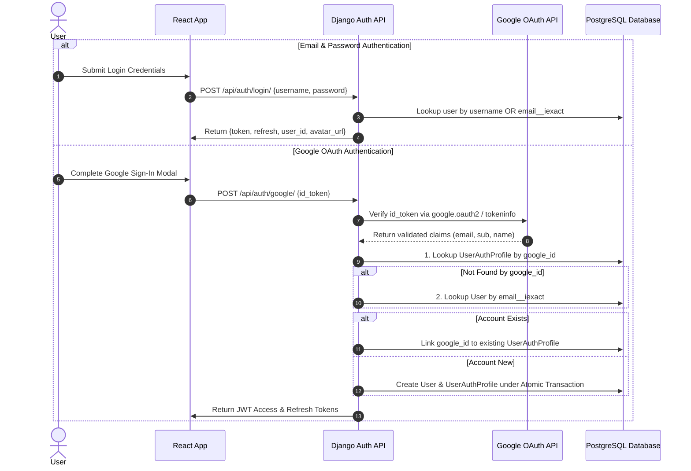
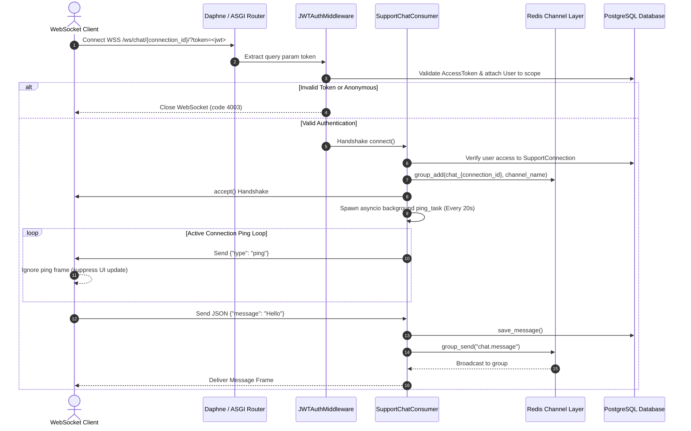

# SoulCare — Technical Architecture & System Design

This document details the internal design, domain models, authentication mechanisms, and real-time streaming pipeline of the **SoulCare** platform.

---

## 1. Authentication & User Unification Architecture



### Key Security & Integrity Features:
1. **Case-Insensitive Unification (`email__iexact`):** Prevents account duplication by matching incoming emails (e.g., `User@Domain.com` vs `user@domain.com`) across both native password and Google OAuth login flows.
2. **SimpleJWT Configuration:** Access tokens expire in 30 minutes; refresh tokens expire in 30 days. Token rotation and blacklisting (`token_blacklist`) are enforced on refresh and logout.
3. **Atomic Operations:** Account creation and profile creation in OAuth sign-in are wrapped inside `@transaction.atomic` blocks to prevent orphaned database records.

---

## 2. Real-Time WebSocket Infrastructure



### Connection Resilience & Fault Tolerance:
- **Ping Heartbeat:** The consumer executes an asynchronous `asyncio.create_task(self.start_ping_loop())` sending `{"type": "ping"}` every 20 seconds. This prevents reverse proxies (such as Render) from dropping connections due to ~30s idle timeouts.
- **Redis Exception Guarding:** Calls to `group_add`, `group_discard`, and `group_send` are wrapped in try/except blocks catching `redis.exceptions.TimeoutError` and `redis.exceptions.ConnectionError`. On error, a graceful error frame (`{"type": "error", "detail": "temporary connection issue, please retry"}`) is delivered to the client instead of crashing the consumer task.

---

## 3. Core Database Models & Domain Schema

The database is divided into decoupled domain applications:

```
+-----------------------------------------------------------------------------------+
|                                  DJANGO AUTH USER                                 |
+-----------------------------------------------------------------------------------+
       |                    |                    |                    |
       | (1:1)              | (1:1)              | (1:1)              | (1:N)
       v                    v                    v                    v
+--------------+     +--------------+     +--------------+     +------------------+
| UserAuth     |     | UserIdentity |     | UserProfile  |     | JournalEntry     |
| Profile      |     | (Avatar Config|     | (Big Five    |     | (Text Entry)     |
+--------------+     +--------------+     |  OCEAN)      |     +------------------+
                            |             +--------------+            |
                            | (1:N)                                   | (1:1)
                            v                                         v
                     +--------------+                          +------------------+
                     | UserCosmetic |                          | Insight          |
                     | Inventory    |                          | (VADER Sentiment)|
                     +--------------+                          +------------------+
```

### Domain App Models Summary

| Application | Model Name | Primary Responsibility | Key Fields & Indexes |
| :--- | :--- | :--- | :--- |
| **authentication** | `UserAuthProfile` | OAuth provider metadata | `google_id` (indexed), `auth_provider`, `avatar_url` |
| **identity** | `UserIdentity` | Avatar seed and style settings | `avatar_provider`, `style_preset`, `identity_config` (JSON) |
| | `CosmeticItem` | Catalog of unlockable accessories | `id` (UUID), `category` (indexed), `layer_key`, `asset_uri` |
| | `UserCosmeticInventory` | Equipped cosmetics per user | `user`, `cosmetic_item`, `is_equipped` |
| **journal** | `JournalEntry` | User private journal entries | `user`, `content`, `created_at` (indexed with `is_deleted`) |
| **insights** | `Insight` | AI sentiment and emotion tags | `journal` (1:1), `mood`, `sentiment_score`, `keywords` (JSON) |
| **support** | `UserProfile` | Big Five (OCEAN) vector scores | `openness`, `conscientiousness`, `extraversion`, `agreeableness`, `neuroticism` |
| | `SupportRequest` | Connection invitation requests | `from_user`, `to_user`, `status` (indexed), `expires_at` |
| | `SupportConnection` | Active peer connections | `connection_id` (UUID), `status`, `alias_user_one`, `alias_user_two` |
| **chat** | `Message` | Real-time chat messages | `message_id` (UUID), `connection`, `sender`, `receiver`, `content` |
| | `TypingIndicator` | Real-time typing status | `connection`, `sender`, `is_typing`, `updated_at` |
| **sleep** | `SleepEntry` | Daily sleep tracking | `user`, `sleep_date` (unique together), `total_sleep_hours`, `sleep_quality` |
| **telemetry** | `CrashReport` | Client-side error telemetry | `report_id` (UUID), `severity`, `stack_trace`, `device_info` |
| | `AnalyticsEvent` | Interaction tracking | `event_name` (indexed), `session_id`, `duration_seconds` |
| | `ClientLog` | Diagnostic log stream | `level`, `module`, `message`, `stack_trace` |
| | `FeedbackItem` | User bug reports and feedback | `category`, `title`, `description`, `status` |
