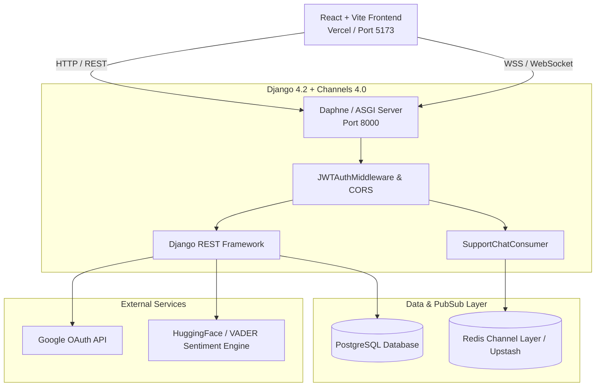

# SoulCare — Emotional Wellness & Peer-Support Platform

SoulCare is a full-stack, real-time emotional wellness platform designed to connect individuals seeking mental health support with empathetic peers based on psychological compatibility and sentiment alignment. The system integrates real-time WebSocket messaging, an AI-powered journaling and sentiment insight engine, sleep tracking, customizable avatar identities, and an adaptive peer-matchmaking algorithm.

---

## Technical Architecture Overview

---

## Tech Stack

| Domain | Technology | Version | Purpose |
| :--- | :--- | :--- | :--- |
| **Backend Core** | Python / Django | Python 3.12, Django 4.2+ | Core application framework & REST services |
| **Real-Time Engine** | Django Channels & Daphne | Channels 4.0+, Daphne 4.0+ | ASGI server and WebSocket pub/sub routing |
| **API Framework** | Django REST Framework | DRF 3.15+ | Serializers, authentication, throttling |
| **Database** | PostgreSQL | PostgreSQL 15+ | Relational data store (dj-database-url) |
| **Cache & Pub/Sub** | Redis | Redis 7+ / `channels-redis` 4.2+ | Channels broadcast layer for real-time chat |
| **Authentication** | SimpleJWT & AllAuth | SimpleJWT 5.3+, AllAuth 0.61+ | JWT token rotation and Google OAuth verification |
| **Frontend** | React + Vite | React 18.2, Vite 5.1 | Single-page application UI |
| **Styling & UI** | TailwindCSS & Lucide | Tailwind 3.4, Lucide React | Styling and responsive design system |

---

## Key Features

1. **Real-Time Peer Chat & Support**
   - Low-latency bi-directional WebSocket communication powered by Django Channels & Redis.
   - Built-in 20-second heartbeat ping/pong mechanism to prevent proxy idle timeouts.
   - Support connection lifecycle management (request, accept, reject, block, disconnect).

2. **Psychological & Sentiment Matchmaking**
   - Big Five (OCEAN) personality vector scoring computed from user journal activity.
   - Dynamic peer suggestion engine matching users based on emotional state and topic compatibility.

3. **AI Journaling & Insight Engine**
   - Natural language analysis utilizing VADER sentiment scoring compound metrics (-1.0 to +1.0).
   - Automated keyword extraction and emotion tagging (e.g., *anxious*, *hopeful*, *reflective*).

4. **Sleep & Wellness Tracker**
   - Daily sleep duration logging, quality ratings, bedtime/wake-time recording, and trend statistics.

5. **Decoupled Identity & Avatar System**
   - Dynamic avatar configuration powered by DiceBear API presets.
   - Unlockable and equippable cosmetic catalog (auras, frames, companions, headwear).

6. **Production Telemetry & Diagnostics**
   - Centralized client crash reporting, event analytics, and user feedback submission system.

---

## Application Screenshots (Placeholders)

> *Placeholders for UI presentation screenshots.*

- **Dashboard & Matchmaking Overview:** ``
- **Real-Time Peer Chat Interface:** ``
- **Journaling & Sentiment Insights:** ``
- **Sleep Metrics Tracker:** ``
- **Avatar & Cosmetics Studio:** ``

---

## Known Limitations & Operational Considerations

- **Render Web Service Cold Starts:** On Render free-tier hosting, the web service enters a dormant state after 15 minutes of inactivity. Initial HTTP/WS requests after dormancy may take ~50 seconds to complete while the instance spins up.
- **Render Proxy Idle Disconnects (Mitigated):** Standard Render reverse proxies terminate idle TCP/WebSocket connections after ~30 seconds without traffic. This has been fully mitigated in production via an automated 20-second server-to-client ping heartbeat and Redis connection retry policies.
- **AI Sentiment Engine Fallback:** The sentiment analysis pipeline uses HuggingFace Inference API when an `HF_API_KEY` is provided. In its absence, the engine automatically falls back to local VADER sentiment analysis and rule-based keyword extraction with zero downtime.
- **Privacy & Anonymity Controls:** User interactions in peer support connections operate via pseudonymous aliases. Soft-delete indicators and moderation fields exist in the schema to support ongoing administrative moderation tools.
